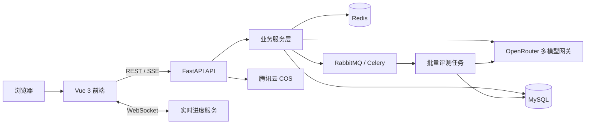

# AI Model Evaluation Platform

一个面向大模型横向评测的全栈平台，提供多模型并行对比、提示词实验、匿名对战、批量测试、AI 评分、成本统计和可视化报告。项目采用 Vue 3 前端与 FastAPI 后端，模型能力通过 OpenRouter 统一接入。

## 项目架构



## 功能模块

- 多模型并排对比：同一提示词并行调用多个模型，通过 SSE 流式展示结果
- Prompt Lab：对同一模型运行多组提示词变体并比较输出
- Battle 匿名对战：隐藏模型身份后进行双模型回答评选
- 场景化批量测试：按预设场景组织测试任务并跟踪执行进度
- AI 自动评分：从准确性、相关性、清晰度等维度生成评分结果
- 评测报告：使用 ECharts 展示统计结果并支持 PDF 导出
- 成本管理：记录 Token 用量、调用成本和用户预算
- 多模态能力：支持图片上传、图片理解、图片生成及联网搜索
- 对话与模型管理：保存对话历史，同步并维护可用模型列表
- 用户与权限：提供注册、登录、会话和基础权限控制

## 技术选型

| 层级 | 技术 |
| --- | --- |
| 前端 | Vue 3、TypeScript、Vite、Pinia、Ant Design Vue |
| 数据可视化 | ECharts、html2canvas、jsPDF |
| 后端 | Python 3.11、FastAPI、Uvicorn、Pydantic |
| AI 接入 | OpenRouter、OpenAI SDK、LangChain |
| 数据存储 | MySQL 8、SQLAlchemy、Redis |
| 异步处理 | RabbitMQ、Celery |
| 实时通信 | SSE、WebSocket、STOMP / SockJS |
| 文件存储 | 腾讯云 COS |
| 部署 | Docker、Docker Compose、Nginx |

## 目录结构

```text
.
|-- backend/              # FastAPI 后端
|   |-- app/api/          # REST API
|   |-- app/services/     # 业务服务
|   |-- app/models/       # 数据模型
|   |-- app/tasks/        # 异步任务
|   `-- requirements.txt
|-- frontend/             # Vue 3 前端
|-- sql/                  # 数据库初始化脚本
`-- docker-compose.yml    # 本地容器编排
```

## 环境要求

- Python 3.11+
- Node.js 22+
- MySQL 8+
- Redis 7+
- RabbitMQ 3.12+
- OpenRouter API Key

## 配置

复制后端环境变量示例，并根据本地环境填写：

```bash
cd backend
cp .env.example .env
```

至少需要配置以下变量：

```dotenv
OPENROUTER_API_KEY=your-openrouter-api-key
SESSION_SECRET_KEY=replace-with-a-random-secret
PASSWORD_SALT=replace-with-a-random-salt
```

生产环境中还应修改数据库、Redis、RabbitMQ 密码，并按需配置腾讯云 COS。

## 本地启动

后端：

```bash
cd backend
python -m venv .venv
source .venv/bin/activate
pip install -r requirements.txt
python -m app.main
```

Windows PowerShell 激活虚拟环境：

```powershell
.\.venv\Scripts\Activate.ps1
```

前端：

```bash
cd frontend
npm install
npm run dev
```

默认地址：

- 前端开发服务：`http://localhost:5173`
- 后端 API：`http://localhost:9090/api`
- Swagger 文档：`http://localhost:9090/api/docs`

## Docker Compose

```bash
docker compose up -d --build
```

容器部署会启动前端、FastAPI、MySQL、Redis 和 RabbitMQ。公开部署前请替换 `docker-compose.yml` 中的示例密码，并通过环境变量注入 API Key 和 Session 密钥。

## 安全提示

- 不要提交 `.env`、API Key、云服务密钥或生产数据库密码
- 示例密码仅用于本地开发，不可直接用于公网环境
- 生产环境应配置 HTTPS、强随机 Session 密钥、独立密码盐值和最小权限账号
- 代码预览功能会运行模型生成的前端脚本，部署时应结合 CSP 和隔离域进一步限制执行环境

